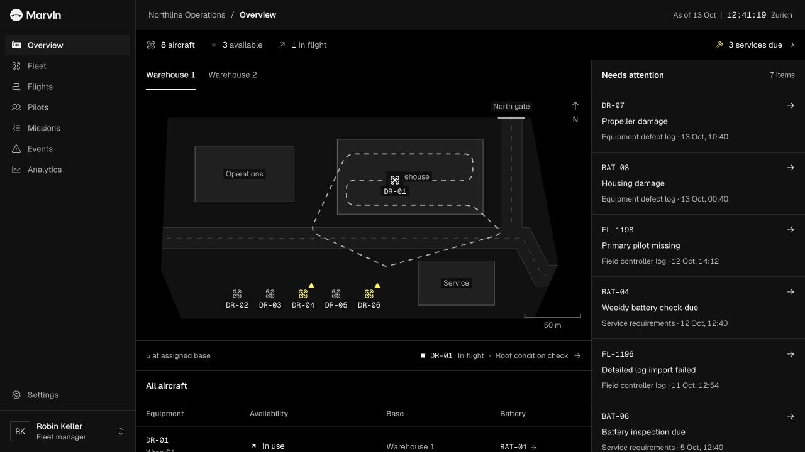
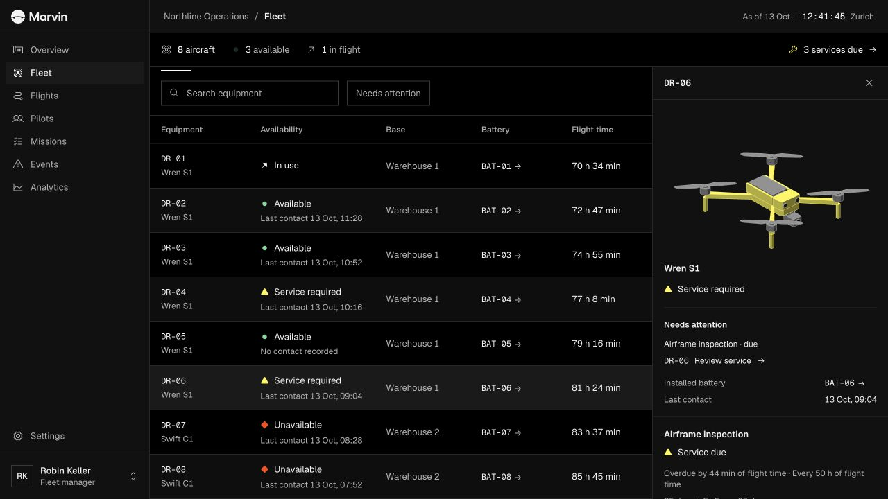

# Marvin

**See what needs attention across a drone fleet.**

Marvin is a self-initiated product design prototype for managing aircraft, batteries, maintenance, pilots and flight records. It connects the fleet overview to the records behind each status, so an operator can investigate an issue and understand what needs to happen next.

[Explore Marvin](https://marvin.hi-3b5.workers.dev) · [Open the interactive demo](https://marvin.hi-3b5.workers.dev/app/overview) · [Nicolas Ménard’s portfolio](https://nicolasmenard.design)

Use a desktop browser for the product demo. The landing page also works on phones.

## Try a workflow

- **Find an aircraft that needs attention.** Start from the Overview map or attention list, then inspect its battery, service requirements and open defects.
- **Record maintenance.** Open Fleet, review a service requirement and record its completion. Availability reflects the remaining service and defect records.
- **Review flight attribution.** Open a completed flight, inspect its primary pilot and correct the attribution with a reason. The record keeps a named change history.
- **Explore fleet activity.** Follow linked flights, missions and events, then compare activity in Analytics.

## Design decisions

**Start with the fleet, then follow the evidence.** The map establishes where aircraft are. Availability and attention items lead to the records that explain their status.

**Show the effect of an edit before saving it.** Maintenance and pilot-correction flows preview the consequences, helping an operator understand what will change.

**Keep different kinds of status distinct.** Flight outcome, summary completeness and detailed-log availability are separate facts. A completed flight can still have a record that needs review.

## Project scope

I designed the product workflows, visual identity and interface, and built the interactive prototype with Next.js, React and TypeScript. The work explores how a dense operational interface can stay readable as people move between maps, tables, charts and detailed records.

All organizations, people, aircraft, missions and operational records in the demo are fictional. Fleet activity is simulated, and management edits reset when the page reloads. The prototype does not connect to or control real aircraft. It demonstrates design and interaction work; it does not claim user validation or measured business results.

This repository presents the project through screenshots and the hosted demo. The application source remains private.

## More work

[See my portfolio and case studies](https://nicolasmenard.design).
